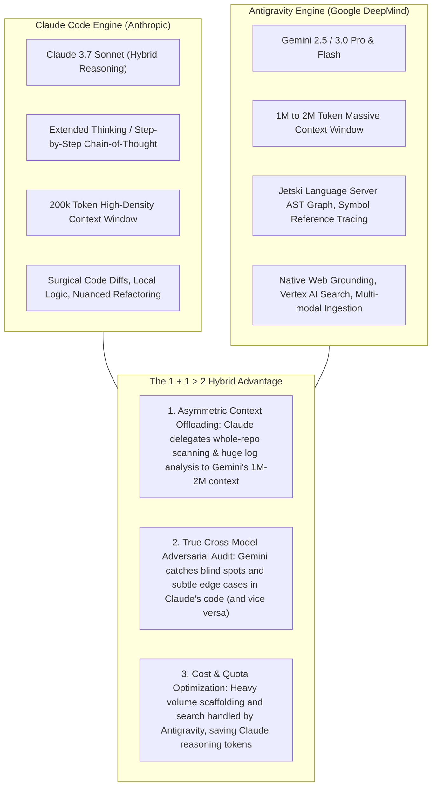
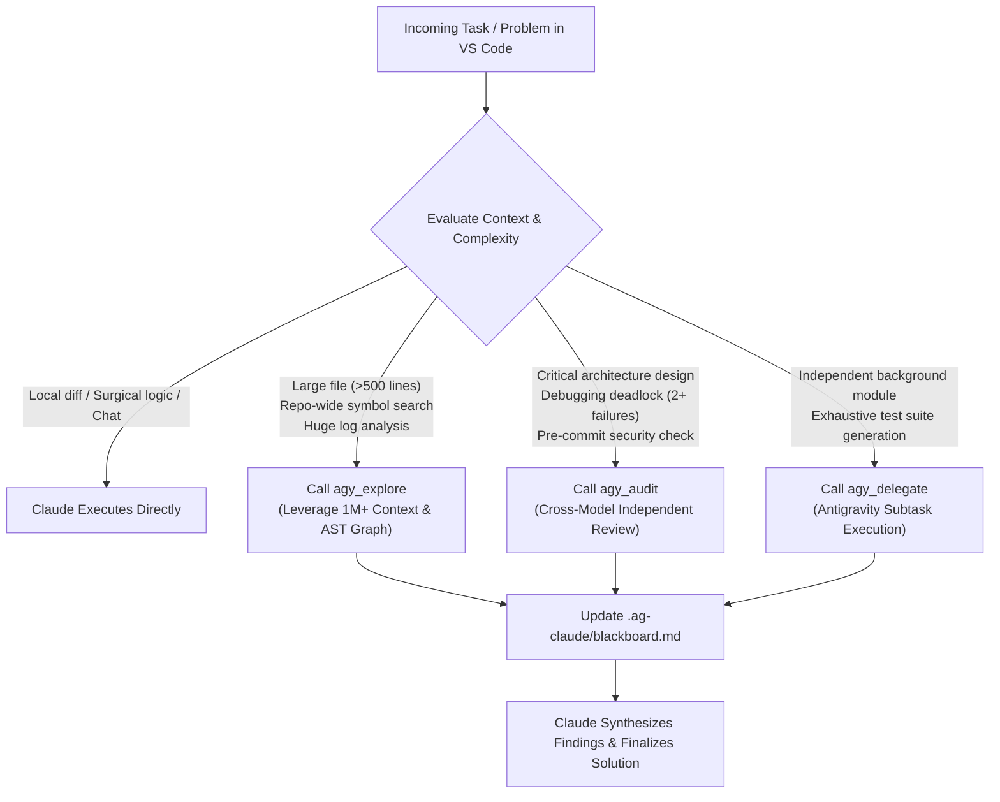

# Antigravity-ClaudeCode Orchestrator Conceptualisation

## Goal Description
Build an autonomous orchestration framework and MCP bridge enabling **Claude Code (`claude`)** (the primary driver in VS Code) and **Antigravity (`agy`)** to co-exist, communicate, and work cooperatively on the same task in the same workspace.

### Deliverables Scope
Per project requirements, the two primary deliverables of this phase are:
1. **This Project Conceptualisation (`conceptualisation.md`)**: Complete architectural design, model routing specifications, comparative analysis, and operational protocols.
2. **User-Facing Project Documentation (`README.md`)**: High-level, developer-friendly guide detailing motivations, architectural comparison, why the two engines complement each other, and how to use the orchestrator in Windows / VS Code.

---

## Comparative Analysis: `yuting0624/antigravity-for-claude-code` vs. Our Orchestrator

The community project [`yuting0624/antigravity-for-claude-code`](https://github.com/yuting0624/antigravity-for-claude-code) demonstrated the early value of connecting Claude Code with Google's Antigravity CLI. However, our orchestrator addresses fundamental architectural limitations and takes the concept significantly further:

| Feature / Dimension | `yuting0624/antigravity-for-claude-code` | Our Antigravity-ClaudeCode Orchestrator |
| :--- | :--- | :--- |
| **Integration Architecture** | Claude Code Plugin (`.claude-plugin/`) with manual slash-commands (`/antigravity:delegate`, `/antigravity:review`). | **Native Model Context Protocol (MCP)** server loaded via `.mcp.json`. Automatically available in VS Code UI without manual slash-commands. |
| **Agent Relationship** | One-way hierarchical subordinate: treats Antigravity merely as a "cheap worker" for boilerplate. | **Cognitive Peer Collaboration**: Respects Antigravity's unique superpowers (1M–2M context, Language Server graph, artifacts) alongside Claude's deep reasoning. |
| **Windows Support** | **Fragile / Problematic**: Relies on Unix pseudo-terminals (`pty`); known to hang or fail on native Windows without WSL/ConPTY wrappers. | **Windows-First & Fully Cross-Platform**: Native PowerShell/Node.js stdio communication with proper process isolation on Windows. |
| **Shared Memory & State** | None: Fire-and-forget subagent outputs; no persistent state between turns. | **Blackboard Architecture**: Shared `.ag-claude/blackboard.md` and `task.json` maintaining shared context, decisions, and subtask tracking. |
| **Decision Autonomy** | Manual user invocation via slash-commands. | **Autonomous Heuristic Engine**: Claude Code autonomously decides when to consult Antigravity based on task complexity, context size, and review needs. |

---

## Deep Engine Comparison: Why Pair Claude Code and Antigravity?

Based on comprehensive analysis of Anthropic and Google DeepMind architectures:

1. **Context Window Asymmetry (200k vs 1M-2M tokens)**:
   - Claude 3.7 Sonnet operates within 200k tokens. In large real-world repositories, ingesting dozens of files or a 20MB trace log leads to truncation or prompt bloat.
   - Antigravity / Gemini features an unprecedented **1M to 2M token context window**, capable of holding entire codebases, complete documentation sets, and exhaustive logs in direct attention.
2. **Cognitive Complementarity**:
   - Claude 3.7 Sonnet excels at nuanced algorithm construction, precision diff application, and human-like iterative discussion in VS Code.
   - Antigravity brings Google's native developer infrastructure: AST-based symbol reference indexing, live Google/Vertex AI search grounding, and multi-modal digestion (audio, video, mockups).
3. **Cross-Model Adversarial Audit**:
   - Having the *same* model review its own code is prone to confirmation bias.
   - Routing architectural plans or complex pull requests between Claude 3.7 Sonnet and Gemini Pro provides genuinely independent cross-family verification.

---

## Model Architecture: Main Agents vs. Subagents

### 1. Claude Code
- **Main Agent Engine**: Runs **Claude 3.7 Sonnet** by default (Anthropic's hybrid reasoning model with dynamic extended thinking). Users can select alternative frontier models (such as Claude 3 Opus) via `ANTHROPIC_MODEL` or `--model`.
- **Subagents**: In Claude Code, subagents (`.claude/agents/*.md`) run in isolated context windows and specify their own models:
  - `model: haiku`: Used for rapid, high-volume searches and basic filtering.
  - `model: sonnet`: Standard implementation and code generation.
  - `model: opus`: Critical architecture planning and deep security reviews.
  - `model: inherit`: Inherits the main agent's model configuration.

### 2. Antigravity (`agy`)
- **Main Agent Engine**: Runs **Gemini 2.5 Pro / 3.0 Pro** or **Gemini 3.8 Flash High** (configurable in settings or via `--model` / `--effort`).
- **Subagents**: Antigravity subagents (`research`, `self`, `image-generator`) can be assigned `flash_lite`, `flash`, `pro`, or `inherit`.

### 3. Cross-Tool Delegation via Orchestrator
- When Claude Code invokes `agy_explore` or `agy_audit`, the orchestrator routes the request to Antigravity's **Gemini 3.0 / 2.5 Pro** engine (or Flash for high-speed indexing).
- The caller (Claude 3.7 Sonnet) receives the distilled, high-context intelligence directly into its VS Code conversation without exceeding its 200k limit.

---

## Autonomous Collaboration Heuristics

Claude Code autonomously determines when to leverage Antigravity based on three primary operational heuristics:

---

## File Deliverables Roadmap

1. **`conceptualisation.md`** (This file): Complete system conceptualisation and theoretical grounding.
2. **`README.md`** (`README.md`): Developer-facing guide detailing:
   - Project Vision & Core Motivation
   - The Complementary Superpowers (Claude 3.7 Sonnet + Gemini Pro/Flash)
   - How It Works in Windows & VS Code
   - Comparison with prior community attempts (`yuting0624`)
   - Autonomous Heuristics & MCP Tool Suite
   - Getting Started & Setup Guide

